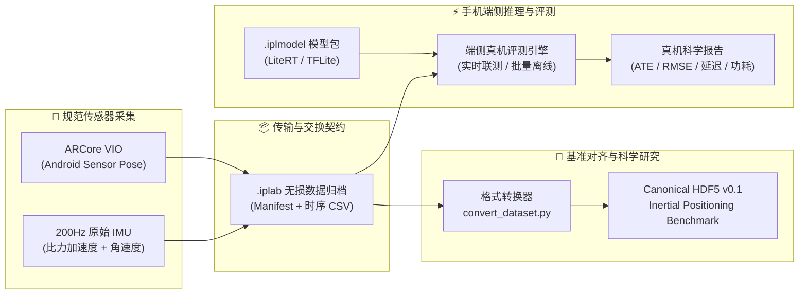

<div align="center">

# 📱 Inertial Positioning Lab

### 面向惯性定位与端侧科学计算的高精度 Android 采集实验与真机评测平台

[](https://developer.android.com)
[](https://kotlinlang.org)
[](https://ai.google.dev/edge/litert)
[](https://developers.google.com/ar)
[](LICENSE)

**Inertial Positioning Lab** 是一款全新设计的 Android 惯性定位与端侧科学计算工程工具。它结合现代移动计算硬件能力，实现高保真度传感器数据规范采集、ARCore VIO 轨迹高保真基准对齐、LiteRT 边缘模型推理与真机多维性能度量。

</div>

---

## 🌟 核心亮点



### ⚡ 1. 200Hz 规范硬件同步采集
- **固定采样基准**：严格以 200 Hz 为采集目标，以陀螺仪硬件时钟为全局基准对齐时间戳。
- **硬件自适应协商**：启动时自动探查加速度计与陀螺仪的 `minDelay` 硬件上限。若硬件能力不足 200 Hz，如实记录实际采样频率并在元数据清单中标记，绝不在端侧静默重采样，确保科学数据严谨可审计。
- **高安全落盘机制**：流式直接写入本地安全文件缓冲，支持自定义持久化存储路径，停止采集后自动校验归档完整性。

### 🎨 2. ARCore VIO 轨迹实时对比画布
- **Sensor Pose 对齐**：采集 Android sensor pose 的局部位置、姿态四元数与差分线速度，与手机 IMU 机体系严格空间重合。
- **实时轨迹画布渲染**：在界面画布中动态渲染俯视局部轨迹（`X 右 / Y 前 / Z 上` 空间映射），实时叠加 IMU 比力及角速度状态。
- **智能漂移抑制与平滑**：显示层配备静止零速锁定、异常突变过滤与跟踪丢失平滑接续机制；原始归档内仍严格保留未经滤波的原始 VIO 位姿数据，满足科研数据无损回溯要求。

### 🚀 3. LiteRT 手机端侧批量推理与联测
- **现代化推理引擎**：基于稳定版 Google LiteRT (TFLite) 运行时构建，完全剥离传统重型依赖。
- **.iplmodel 标准封装**：支持通过模型描述清单将输入输出维度、归一化参数及模型二进制打成标准 `.iplmodel` 包。
- **双模态测试架构**：
  - **实时边采边测（Live Testing）**：采集传感器数据的同时流水线驱动端侧模型执行前向推理，实时在画布中动态叠加模型估计轨迹与 VIO 参考轨迹，实时计算端点漂移。
  - **多模型批量离线测试（Batch Benchmark）**：支持批量加载多个 `.iplab` 序列与多个 `.iplmodel` 模型，全自动遍历“模型 × 数据集”矩阵。

### 📊 4. .iplab 规范格式与真机多维指标评测
- **多维科学指标评估**：
  - **精度指标**：绝对轨迹误差（ATE, Absolute Trajectory Error）、速度均方根误差（RMSE）、累积漂移率（Drift Ratio %）；
  - **延迟剖析**：精确记录端侧前向推理耗时，统计中位数（p50）、90分位数（p90）、99分位数（p99）及最大延迟抖动；
  - **能效与系统负载**：吞吐量（FPS）、CPU 使用率、内存驻留峰值、设备热状态（Thermal State）及电量计能量消耗监控。

---

## 📐 技术规格矩阵

| 维度 | 指标与规格 | 说明 |
| :--- | :--- | :--- |
| **支持平台** | Android 8.0+ (API 26+) | 现代化 Kotlin + Jetpack Compose + Material 3 架构 |
| **传感器目标率** | 200 Hz (固定基准) | 硬件不足时如实回退记录，杜绝黑盒插值 |
| **参考位姿源** | Google ARCore 视觉惯性里程计 (VIO) | 采用 Android Sensor Pose，对齐机体物理坐标系 |
| **端侧推理框架** | Google LiteRT (TensorFlow Lite) | 支持 CPU 多线程与硬件加速 Delegate |
| **归档格式** | `.iplab` (无损 ZIP 交换归档) | 内嵌 `manifest.json` 与时序 `data/sequence.csv` |
| **基准项目支持** | Canonical HDF5 v0.1 | 无缝对接 [Inertial Positioning Benchmark](https://github.com/BUG423/inertial-positioning-benchmark) |
| **模型分发格式** | `.iplmodel` 自包含模型规范包 | 包含模型权重、预处理元数据、输入输出契约 |

---

## 📦 数据交换格式 (.iplab)

导出的 `.iplab` 文件是无损传输的标准化 ZIP 归档，包含实验元数据清单及对齐后的时序数据：

### 1. 元数据清单 (`manifest.json`)
```json
{
  "archive_format": "inertial-lab/1",
  "schema_version": "0.1",
  "dataset": "InertialLab",
  "sequence_id": "lab_walk_20261010_01",
  "world_frame": "arcore_local_x_right_y_forward_z_up",
  "timestamp_type": "relative",
  "orientation_convention": "body_to_world_wxyz",
  "accelerometer_type": "specific_force",
  "position_source": "ARCore visual-inertial odometry",
  "orientation_source": "ARCore Android sensor pose",
  "sample_rate_hz": 200,
  "started_at_utc": "2026-10-10T12:00:00Z"
}
```

### 2. 时序数据列契约 (`data/sequence.csv`)
| 字段组 | 包含列名 | 数据单位与约定 |
| :--- | :--- | :--- |
| **时间轴** | `timestamp` | 相对秒（严格单调递增） |
| **机体角速度** | `gyro_x`, `gyro_y`, `gyro_z` | $\text{rad/s}$，Android 手机机体坐标系 |
| **机体比力** | `accel_x`, `accel_y`, `accel_z` | $\text{m/s}^2$，包含重力比力 |
| **空间姿态** | `orientation_w/x/y/z` | 单位四元数，满足 $\text{body} \to \text{world}$ 变换 |
| **参考位置** | `position_x`, `position_y`, `position_z` | 米（m），以首个稳定锚点为原点的局部参考坐标 |
| **参考速度** | `velocity_x`, `velocity_y`, `velocity_z` | $\text{m/s}$，相邻有效位姿时间差分导出 |
| **有效性掩码** | `valid_imu`, `valid_orientation`, `valid_position` | 二进制标量（`0` 表示无效/丢失，`1` 表示可靠） |

---

## 🛠️ 数据转换与工具链

通过内置的 Python 工具链，可轻松实现从 `.iplab` 手机归档到科研 Canonical HDF5 数据集的一键转换：

```bash
# 准备环境
python -m venv .venv
source .venv/bin/activate
python -m pip install -r requirements-dev.txt

# 运行自动化单元测试
pytest -q

# 将 .iplab 转换为 Benchmark Canonical HDF5
python tools/convert_dataset.py recording.iplab -o ./datasets/converted/
```

转换器会自动校验数值有限性、时间单调性、单位四元数模长范数与有效性掩码，输出符合标准规范的 `sequences/<id>.h5`。

### 模型打包工具 (`pack_model.py`)
```bash
python tools/pack_model.py \
  --model model.tflite \
  --manifest manifest.json \
  --output my_model.iplmodel
```

---

## 📱 Android 工程构建

本项目使用现代 Android 技术栈（Kotlin 2.0+、Jetpack Compose、Gradle 8.13），要求 **JDK 17** 及 **Android SDK 36**。

```bash
# 赋予 gradlew 执行权限
chmod +x gradlew

# 执行单元测试与 Lint 静态分析
./gradlew testDebugUnitTest lintDebug

# 构建 Debug 调试测试包
./gradlew assembleDebug
```

构建成功后，APK 产物生成于：
`app/build/outputs/apk/debug/app-debug.apk`

> [!NOTE]
> - 本工具采用 Android debug 签名打包，供真机数据采集与实验评测使用；
> - ARCore 为可选增强特性；在未安装或不支持 ARCore 的设备上，应用仍可稳定进行高频纯 IMU 数据采集。

---

## ⚠️ 科学研究与工程边界

1. **ARCore 参考源定位**：ARCore 融合了单目视觉与机载 IMU，并非完全解耦的独立动捕（如 Vicon / OptiTrack）真值。科研报告中须明确声明基准来源为 `ARCore VIO Reference`。
2. **相机数据隐私保护**：相机图像仅在 ARCore 底层算法内部消费，本应用绝对不捕获、不渲染、不缓存、不持久化任何图像数据。
3. **频率严谨性**：拒绝在手机端进行任何隐式重采样；若硬件无法稳定输出 200 Hz，须在数据清单中如实反映。

---

## 📄 开源许可证

本项目采用 **Creative Commons Attribution-NonCommercial-NoDerivatives 4.0 International (CC BY-NC-ND 4.0)** 许可协议。

- 仅允许个人学习、学术交流与非商业性科研用途。
- 严禁任何形式的商业分发、收费服务或闭源预装。
- 完整授权条款请参见 [LICENSE](LICENSE)。
